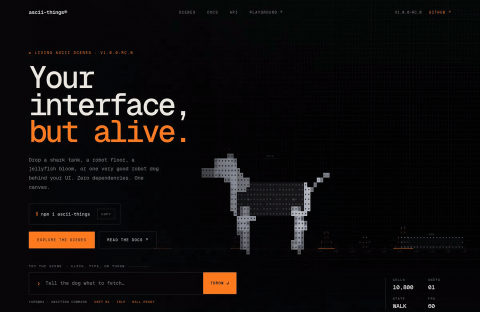

# ascii-things



*The landing page, live. Type a command and the dog fetches the ball.*

**Living ASCII scenes.** A shark tank, robot factory, jellyfish bloom,
robot dog, starling murmuration, firefly meadow, ant trail, koi pond, city
grid, and server room — drawn as glyphs on a canvas. The collection keeps
growing. Zero runtime dependencies. MIT.

The optional `ascii-things/ui` subpath adds a framed stage, command input, live
readout, scene tabs, panels, toolbars, status readouts, and ready-made scene
heroes for React hosts.

Each scene is a small artificial-life simulation, not a looped animation.
Sharks hunt fish that spread alarm through the school. Robots patrol, scan,
haul cargo, and queue for a charging bay. Jellyfish pulse through a current,
trailing tentacles and leaving rings of light. A robot dog trots, sniffs, sits,
chases a ball, and docks to recharge. Starlings murmur around a predator.
Fireflies drift and blink. Ants forage along pheromone trails. Koi circle a pond
and rise for crumbs. Traffic crosses a lit city grid. Packets move between
server racks. Same seed and size produce the same scene.

The research and extraction plan are in [`RESEARCH.md`](./RESEARCH.md). The documentation
site lives in [`site/`](./site/) (Astro + Starlight); it builds to a static site with the
landing page at `/`, the guides under `/guide/`, and a page for every scene under
`/scenes/`.

**Release:** `1.0.0-rc.0`. The public runtime, type, and subpath exports are
frozen for 1.0. See [`MIGRATION.md`](./MIGRATION.md).

## Install

```sh
npm install ascii-things
```

`1.0.0-rc.0` is the release candidate and is not on npm yet. Until the 1.0
publish, build from this repository or install the tarball from `npm pack`.

Or, once the package is published, use the custom elements from a CDN:

```html
<script type="module" src="https://cdn.jsdelivr.net/npm/ascii-things@latest/dist/element.js"></script>

<ascii-sharks palette="abyss" seed="42" style="height: 480px"></ascii-sharks>
<ascii-robots palette="paper" seed="7" style="height: 420px"></ascii-robots>
<ascii-jellyfish palette="neon" seed="3" style="height: 460px"></ascii-jellyfish>
<ascii-dog palette="paper" seed="7" style="height: 420px"></ascii-dog>
<ascii-starlings palette="abyss" seed="11" style="height: 420px"></ascii-starlings>
<ascii-fireflies palette="abyss" seed="13" style="height: 420px"></ascii-fireflies>
<ascii-ants palette="abyss" seed="17" style="height: 420px"></ascii-ants>
<ascii-koi palette="paper" seed="19" style="height: 420px"></ascii-koi>
<ascii-city palette="neon" seed="23" style="height: 420px"></ascii-city>
<ascii-servers palette="abyss" seed="29" style="height: 420px"></ascii-servers>
```

## Vanilla

```ts
import { createSharks } from "ascii-things/sharks";

const scene = createSharks(canvas, {
  sharks: [
    { kind: "hammerhead", size: 1 },
    { kind: "mako", size: 0.8 },
  ],
  palette: "abyss",
  seed: 42,
  density: 0.9,
  interactive: true,
});

scene.pause();
scene.resume();
scene.setOptions({ palette: "paper", speed: 0.8 });
console.log(scene.getStats());
scene.destroy();
```

The canvas needs a size from CSS. `createSharks` fills whatever box the canvas
occupies and watches it with `ResizeObserver`.

## Robots

```ts
import { createRobots } from "ascii-things/robots";

const floor = createRobots(canvas, {
  robots: [
    { kind: "scout", size: 1 },
    { kind: "hauler", size: 1.15 },
    { kind: "sentinel", size: 1 },
  ],
  palette: "paper",
  seed: 7,
  count: 8,
  interactive: true,
});

floor.setOptions({ palette: "neon", speed: 1.4 });
console.log(floor.getStats());
```

Robots patrol, stop to scan, avoid crates and each other, and return to a
charging bay when their battery gets low. Click the floor to dispatch the
nearest idle robot to that spot. `getStats()` returns `robots`, `charging`,
`docks`, `cells`, and frame timing.

## Jellyfish

```ts
import { createJellyfish } from "ascii-things/jellyfish";

const bloom = createJellyfish(canvas, {
  jellies: [
    { kind: "moon", size: 1.15 },
    { kind: "lion", size: 0.95 },
    { kind: "atolla", size: 1.05 },
  ],
  palette: "abyss",
  seed: 3,
  interactive: true,
});

bloom.setOptions({ palette: "neon", speed: 0.9 });
console.log(bloom.getStats());
```

Jellyfish pulse along their heading, ride a divergence-free current, trail
tentacles and oral arms, and leave a ring of light on every contraction. Move
the pointer to nudge the bloom; click to send a shockwave. `getStats()` returns
`jellies`, `pulsing`, `plankton`, `rings`, `cells`, and frame timing.

## Robot dog

```ts
import { createDog } from "ascii-things/dog";

const yard = createDog(canvas, {
  dogs: [{ size: 1 }, { size: 1.15 }],
  palette: "paper",
  seed: 7,
  interactive: true,
});

yard.setOptions({ palette: "neon", speed: 1.2 });
console.log(yard.getStats());
```

The dog trots around a test yard, changes gait, stops to sniff or sit, and
returns to its dock when the battery gets low. Click anywhere to throw the
ball; the nearest dog gives chase and nudges it. `getStats()` returns `dogs`,
`charging`, `state`, `ball`, `cells`, and frame timing.

## Ambient scenes

Six ambient habitats share the same handle, options, and action API:

| Scene | Factory | Action | Default count | Stats extras |
|---|---|---|---|---|
| Starlings | `createStarlings` | `scatter(x, y)` | `110` | `birds`, `predators` |
| Fireflies | `createFireflies` | `flare(x, y)` | `70` | `fireflies`, `lit` |
| Ants | `createAnts` | `crumb(x, y)` | `44` | `ants`, `food`, `carrying` |
| Koi | `createKoi` | `feed(x, y)` | `7` | `koi`, `ripples` |
| City | `createCity` | `rush(x, y)` | `18` | `cars`, `buildings`, `lights` |
| Servers | `createServers` | `ping(x, y)` | `8` | `servers`, `packets`, `alerts` |

```ts
import { createStarlings } from "ascii-things/starlings";

const flock = createStarlings(canvas, {
  count: 110,
  palette: "abyss",
  seed: 11,
  interactive: true,
});

flock.scatter(canvas.clientWidth * 0.6, canvas.clientHeight * 0.4);
console.log(flock.getStats()); // birds, predators, cells, fps...
```

Starlings use boids rules around a moving predator. Fireflies drift across a
dusk meadow and blink. Ants leave decaying pheromone trails while carrying
crumbs home. Koi seek food, ripple the surface, and occasionally nibble.
City traffic wraps a lit grid. Server packets travel between racks and raise
an alert when a ping completes. Every scene also exposes `trigger(action, x, y)`
and the common lifecycle methods.

Full scene pages: [starlings](/scenes/starlings/), [fireflies](/scenes/fireflies/),
[ants](/scenes/ants/), [koi](/scenes/koi/), [city](/scenes/city/), and
[servers](/scenes/servers/).

## React

```tsx
import { AsciiSharks } from "ascii-things/react";

export function Hero() {
  return (
    <div style={{ height: 520 }}>
      <AsciiSharks
        sharks={[{ kind: "greathammer", size: 1.1 }]}
        palette="abyss"
        seed={42}
        label="A live ASCII shark tank"
      />
    </div>
  );
}
```

```tsx
import { AsciiRobots } from "ascii-things/react";

export function Factory() {
  return (
    <div style={{ height: 420 }}>
      <AsciiRobots
        robots={[{ kind: "hauler", size: 1.2 }, { kind: "scout" }]}
        palette="paper"
        seed={7}
        label="A live ASCII robot factory floor"
      />
    </div>
  );
}
```

```tsx
import { AsciiJellyfish } from "ascii-things/react";

export function Bloom() {
  return (
    <div style={{ height: 460 }}>
      <AsciiJellyfish
        jellies={[{ kind: "atolla", size: 1.05 }, { kind: "moon", size: 1.15 }]}
        palette="neon"
        seed={3}
        label="A live ASCII jellyfish bloom"
      />
    </div>
  );
}
```

```tsx
import { AsciiDog } from "ascii-things/react";

export function Yard() {
  return (
    <div style={{ height: 420 }}>
      <AsciiDog
        dogs={[{ size: 1 }, { size: 1.15 }]}
        palette="paper"
        seed={7}
        label="A live ASCII robot dog test yard"
      />
    </div>
  );
}
```

```tsx
import { AsciiStarlings } from "ascii-things/react";

export function Murmuration() {
  return (
    <div style={{ height: 420 }}>
      <AsciiStarlings
        count={110}
        palette="abyss"
        seed={11}
        label="A live ASCII starling murmuration"
      />
    </div>
  );
}
```

The wrappers are client components (`"use client"`), fill their parent by
default, and clean up on unmount. The ambient wrappers are `AsciiStarlings`,
`AsciiFireflies`, `AsciiAnts`, `AsciiKoi`, `AsciiCity`, and `AsciiServers`.
`palette`, `speed`, `columns`, `maxCells`, `adaptiveQuality`, `calm`, `label`,
`paused`, and `fontFamily` update live. Structural options (`sharks`, `robots`,
`jellies`, `dogs`, `seed`, `density`, `count`, `sharkScale`, `scale`) remount
the scene when they change.

Each wrapper also accepts `id`, `aspectRatio` (for example `"16 / 9"` or a
number), and `onReady(scene)`, which fires after the scene engine mounts. Use
`paused` to start with the clock stopped and `fontFamily` to override the
canvas font stack.

## UI components

`ascii-things/ui` is an optional, zero-dependency React layer for the interface
around a scene: framed stages, command inputs, live readouts, scene tabs,
panels, toolbars, toggles, status readouts, dividers, and ready-made scene
heroes. It uses plain CSS variables, not Tailwind. Import the stylesheet once.

```tsx
import { AsciiDogHero } from "ascii-things/ui";
import "ascii-things/ui.css";

export function Hero() {
  return <AsciiDogHero palette="abyss" seed={7} />;
}
```

The recipe wires the dog, prompt, stage, and live stats together. To compose
your own layout, use the pieces directly:

```tsx
import { useState } from "react";
import { AsciiDog } from "ascii-things/react";
import {
  AsciiPrompt,
  AsciiReadout,
  AsciiSceneTabs,
  AsciiStage,
} from "ascii-things/ui";
import "ascii-things/ui.css";

export function Yard() {
  const [palette, setPalette] = useState<"abyss" | "paper" | "neon" | "mono">("abyss");

  return (
    <div>
      <AsciiSceneTabs
        scenes={[
          { id: "abyss", label: "Abyss", meta: "night" },
          { id: "paper", label: "Paper", meta: "day" },
          { id: "neon", label: "Neon", meta: "loud" },
          { id: "mono", label: "Mono", meta: "quiet" },
        ]}
        value={palette}
        onChange={(id) => setPalette(id as typeof palette)}
      />

      <AsciiStage
        label="ROBOT DOG / TEST YARD"
        status="LIVE"
        aspectRatio="4 / 3"
        footer={
          <AsciiReadout
            items={[
              { label: "SCENE", value: "DOG" },
              { label: "PALETTE", value: palette.toUpperCase() },
            ]}
          />
        }
      >
        <AsciiDog palette={palette} seed={7} />
      </AsciiStage>

      <AsciiPrompt
        label="Tell the dog what to fetch"
        placeholder="Throw the ball…"
        actionLabel="Throw"
        status="Awaiting command"
        onSubmit={(command) => console.log(command)}
      />
    </div>
  );
}
```

Components: `AsciiStage`, `AsciiPrompt`, `AsciiReadout`, `AsciiSceneTabs`,
`AsciiButton`, `AsciiToolbar`, `AsciiToggle`, `AsciiPanel`, `AsciiStatus`,
`AsciiDivider`, and `AsciiDogHero`. `AsciiSceneHero` is the generic hero for any
habitat, with `AsciiSharkHero`, `AsciiRobotHero`, `AsciiJellyfishHero`,
`AsciiStarlingsHero`, `AsciiFirefliesHero`, `AsciiAntsHero`, `AsciiKoiHero`,
`AsciiCityHero`, and `AsciiServersHero` presets. `useAsciiScene` exposes the
same engine handle for custom layouts.

Theme them with `--ascii-accent`, `--ascii-bg`, `--ascii-ink`, `--ascii-font`,
and `--ascii-radius`. Containers are square by default; only true indicators
(dots, toggle thumb, toggle track) stay round. The components are
framework-light React, so they work beside shadcn: keep shadcn `Input`/`Button`
for page chrome, or put your own controls over `AsciiStage` and use only the
scene beneath.

See the [UI example](examples/ui/) for the full composition. The
[scene console](https://ascii-things-docs.pages.dev/components/scene-console/) and
[scene toolbar](https://ascii-things-docs.pages.dev/components/scene-toolbar/)
registry items show the same primitives as copyable source.

## Image to ASCII

`ascii-things/image` turns a local image, `Blob`, `ImageBitmap`, canvas, or URL
into monochrome or colour ASCII. It is a separate tree-shakeable entry, not a
living scene, and has no runtime dependencies.

The docs site includes a full [image-to-ASCII studio](https://ascii-things-docs.pages.dev/image/)
with crop, edge detection, batch conversion, and TXT, PNG, SVG, and ZIP export.

```ts
import { imageToAscii, renderAsciiImage } from "ascii-things/image";

const text = await imageToAscii(file, {
  columns: 80,
  charset: "classic",
  dither: "floyd-steinberg",
});

await renderAsciiImage(canvas, file, {
  columns: 80,
  color: true,
});
```

### React

```tsx
import { AsciiImage } from "ascii-things/image/react";

export function Portrait({ file }: { file: File }) {
  return (
    <AsciiImage
      src={file}
      columns={80}
      dither="bayer"
      alt="A portrait rendered in ASCII"
    />
  );
}
```

`AsciiImage` renders a canvas with `role="img"` and the supplied `alt` text.
The optional `onRender(result)` and `onError(error)` callbacks expose the plain
text, dimensions, and per-cell colours.

### HTML custom element

```html
<script type="module" src="https://cdn.jsdelivr.net/npm/ascii-things@latest/dist/image-element.js"></script>

<ascii-image
  src="/portrait.png"
  columns="80"
  charset="classic"
  brightness="0.05"
  gamma="1.1"
  label="A portrait rendered in ASCII"
></ascii-image>
```

The element dispatches bubbling, composed `ascii-ready` and `ascii-error`
events. Attributes: `src`, `columns`, `charset`, `invert`, `dither`, `contrast`,
`brightness`, `gamma`, `color`, `foreground`, `background`, `font-family`, and
`label`.

| Option | Type | Default | |
|---|---|---|---|
| `columns` | `number` | `80` | Characters across; 8–400 |
| `charset` | `"classic" \| "blocks" \| "dots" \| string` | `"classic"` | Custom ramps run dark to light |
| `invert` | `boolean` | `false` | Flip the ramp |
| `dither` | `"none" \| "floyd-steinberg" \| "bayer"` | `"none"` | Opt-in error diffusion or ordered dithering |
| `contrast` | `number` | `1` | Multiplier around mid-grey; 0.1–4 |
| `brightness` | `number` | `0` | Luminance offset; −1–1 |
| `gamma` | `number` | `1` | Gamma correction; 0.2–4 |
| `color` | `boolean` | `false` | Draw from the source pixels |
| `foreground` | `string` | `"#ece8df"` | Monochrome ink |
| `background` | `string` | `"#070809"` | Canvas background |
| `fontFamily` | `string` | Geist Mono stack | Drawing font |

`imageToAscii` returns the plain text. `renderAsciiImage` returns
`{ text, columns, rows, colors }` and draws to a canvas. Both accept `File`,
`Blob`, `HTMLImageElement`, `ImageBitmap`, `HTMLCanvasElement`, or a URL. Remote
URLs must allow CORS; local files avoid that requirement.

Use the [live image studio](https://ascii-things-docs.pages.dev/image/) for
drag-and-drop, paste, URL loading, crop, edge detection, batch conversion, and
TXT, PNG, SVG, and ZIP export. The smaller [image demo](examples/image/) stays
available as a minimal integration reference.

## Dither field

`ascii-things/dither` renders an ordered-dither dot field with a legible
wordmark and a moving accent scan. It is a separate tree-shakeable entry, not a
scene, and has no runtime dependencies.

```ts
import { DitherField } from "ascii-things/dither";

const field = new DitherField(canvas, {
  text: "ASCII-THINGS",
  matrix: "bayer4",
  density: 0.1,
});

// later
field.destroy();
```

`DitherField` owns resize, visibility, and reduced-motion handling.
`ditherThreshold(matrix, x, y)` and `shouldDither(value, matrix, x, y)` expose
the ordered thresholds for custom passes.

### React

```tsx
import { AsciiDither } from "ascii-things/dither/react";

export function Card() {
  return <AsciiDither text="ASCII-THINGS" matrix="bayer4" style={{ height: 240 }} />;
}
```

### HTML custom element

```html
<script type="module" src="https://cdn.jsdelivr.net/npm/ascii-things@latest/dist/dither-element.js"></script>

<ascii-dither
  text="ASCII-THINGS"
  matrix="bayer4"
  density="0.1"
  word-density="0.78"
></ascii-dither>
```

Attributes: `text`, `matrix`, `cell`, `density`, `word-density`, `scan`,
`speed`, `foreground`, `accent`, `background`, `font-family`, `label`, `paused`.

| Option | Type | Default | |
|---|---|---|---|
| `text` | `string` | `"ASCII-THINGS"` | Wordmark rendered inside the field |
| `matrix` | `"bayer2" \| "bayer4" \| "bayer8" \| "none"` | `"bayer4"` | Ordered dither pattern |
| `cell` | `number` | `0` | Dot spacing in CSS pixels; `0` derives from the width |
| `density` | `number` | `0.1` | Background dot density, 0–1 |
| `wordDensity` | `number` | `0.78` | Density inside the wordmark, 0–1 |
| `scan` | `boolean` | `true` | Animated accent scan band |
| `speed` | `number` | `1` | Motion multiplier |
| `foreground` | `string` | `"rgba(236,232,223,0.7)"` | Ink colour |
| `accent` | `string` | `"rgba(255,122,26,0.92)"` | Scan colour |
| `background` | `string` | `"transparent"` | Canvas background |
| `fontFamily` | `string` | Geist Mono stack | Wordmark font |

See the [dither demo](examples/dither/) for live text, matrix, density, scan,
and motion controls.

## WebGL surface

`ascii-things/webgl` renders a living ASCII glyph field with an optional
wordmark, an accent scan, and pointer response. It uses a WebGL fragment shader
with a generated glyph atlas and falls back to a 2D glyph field when WebGL is
unavailable. It is a separate tree-shakeable entry with no runtime
dependencies.

```ts
import { AsciiSurfaceEngine } from "ascii-things/webgl";

const surface = new AsciiSurfaceEngine(canvas, {
  text: "ASCII-THINGS",
  glyphs: ".:-=+*#%@",
  density: 0.16,
  pointer: true,
});

surface.renderer; // "webgl" | "2d" | "none"

// later
surface.destroy();
```

### React

```tsx
import { AsciiSurface } from "ascii-things/webgl/react";

export function Hero() {
  return <AsciiSurface text="ASCII-THINGS" density={0.16} style={{ height: 320 }} />;
}
```

### HTML custom element

```html
<script type="module" src="https://cdn.jsdelivr.net/npm/ascii-things@latest/dist/webgl-element.js"></script>

<ascii-surface text="ASCII-THINGS" glyphs=".:-=+*#%@" density="0.16"></ascii-surface>
```

Attributes: `text`, `glyphs`, `cell`, `density`, `speed`, `scan`, `pointer`,
`foreground`, `accent`, `background`, `font-family`, `max-dpr`, `label`,
`paused`. The host carries `data-renderer="webgl" | "2d"`.

| Option | Type | Default | |
|---|---|---|---|
| `text` | `string` | `"ASCII-THINGS"` | Wordmark that emerges from the field |
| `glyphs` | `string` | `".:-=+*#%@"` | Character ramp, low brightness first |
| `cell` | `number` | `0` | Glyph cell height in CSS pixels; `0` derives from the width |
| `density` | `number` | `0.16` | Ambient field density, 0–1 |
| `speed` | `number` | `1` | Wave and scan multiplier |
| `scan` | `boolean` | `true` | Animated accent scan band |
| `pointer` | `boolean` | `true` | Brighten glyphs near a fine pointer |
| `foreground` | `string` | `"#ece8df"` | Ink colour |
| `accent` | `string` | `"#ff7a1a"` | Scan and pointer colour |
| `background` | `string` | `"transparent"` | Canvas background |
| `fontFamily` | `string` | Geist Mono stack | Atlas and mask font |
| `maxDpr` | `number` | `2` | Backing-store pixel ratio cap |

See the [WebGL demo](examples/webgl/) for live text, ramp, density, cell, speed,
scan, pointer, and motion controls.

## HTML custom element

```html
<ascii-sharks
  palette="paper"
  seed="7"
  density="0.7"
  sharks="tiger:1,thresher:0.85"
  interactive
  label="A live ASCII shark tank"
></ascii-sharks>
```

```html
<ascii-robots
  palette="paper"
  seed="7"
  count="8"
  robots="scout:1,hauler:1.2,sentinel:1"
  interactive
  label="A live ASCII robot factory floor"
></ascii-robots>
```

```html
<ascii-jellyfish
  palette="neon"
  seed="3"
  jellies="moon:1.15,lion:0.95,atolla:1.05"
  interactive
  label="A live ASCII jellyfish bloom"
></ascii-jellyfish>
```

```html
<ascii-dog
  palette="paper"
  seed="7"
  count="2"
  dogs="1,1.15"
  interactive
  label="A live ASCII robot dog test yard"
></ascii-dog>
```

The ambient elements use the same attribute pattern:

```html
<ascii-starlings palette="abyss" seed="11" count="110" interactive></ascii-starlings>
<ascii-fireflies palette="abyss" seed="13" count="70" interactive></ascii-fireflies>
<ascii-ants palette="abyss" seed="17" count="44" interactive></ascii-ants>
<ascii-koi palette="paper" seed="19" count="7" interactive></ascii-koi>
<ascii-city palette="neon" seed="23" count="18" interactive></ascii-city>
<ascii-servers palette="abyss" seed="29" count="8" interactive></ascii-servers>
```

Shark attributes: `palette`, `seed`, `density`, `speed`, `columns`, `max-cells`,
`max-dpr`, `adaptive-quality`, `calm`, `interactive`, `sharks`, `shark-scale`,
`label`, `aspect-ratio`, `paused`, `font-family`.

Robot attributes: `palette`, `seed`, `count`, `speed`, `columns`, `max-cells`,
`max-dpr`, `adaptive-quality`, `calm`, `interactive`, `robots`, `scale`,
`label`, `aspect-ratio`, `paused`, `font-family`.

Jellyfish attributes: `palette`, `seed`, `count`, `speed`, `columns`,
`max-cells`, `max-dpr`, `adaptive-quality`, `calm`, `interactive`, `jellies`,
`scale`, `label`, `aspect-ratio`, `paused`, `font-family`.

Dog attributes: `palette`, `seed`, `count`, `speed`, `columns`, `max-cells`,
`max-dpr`, `adaptive-quality`, `calm`, `interactive`, `dogs`, `spread`, `scale`,
`label`, `aspect-ratio`, `paused`, `font-family`.

Ambient elements (`ascii-starlings`, `ascii-fireflies`, `ascii-ants`,
`ascii-koi`, `ascii-city`, `ascii-servers`) share: `palette`, `seed`, `count`,
`scale`, `speed`, `columns`, `max-cells`, `max-dpr`, `adaptive-quality`,
`calm`, `interactive`, `label`, `aspect-ratio`, `paused`, `font-family`.

Every custom element dispatches a bubbling, composed `ascii-ready` event after
the engine mounts. The event detail is `{ scene }`, where `scene` is the engine
handle.

## Examples

- **Landing page** ([index.html](index.html)) — the library site with a live dog
  hero, scene gallery, install snippets, and design notes.
- [Playground](examples/playground/) — the query-string demo for every scene.
- [UI layer](examples/ui/) — first-party React components composing the dog,
  stage, prompt, readout, and palette tabs.
- [Design system recipes](https://ascii-things-docs.pages.dev/guide/design-systems/) —
  shadcn/ui, Material UI, Tailwind, and custom-element integration patterns.
- [Components](https://ascii-things-docs.pages.dev/components/) — copyable shadcn
  registry items for an ASCII box footer, koi card, dither card, surface card,
  scene console, and scene toolbar.
- [Image to ASCII studio](https://ascii-things-docs.pages.dev/image/) — crop,
  edge detection, batch conversion, and TXT/PNG/SVG/ZIP export.
- [Image to ASCII example](examples/image/) — the minimal drag-and-drop
  integration with charset, contrast, dithering, colour, copy, and download.
- [Dither field](examples/dither/) — an ordered-dither wordmark with live matrix,
  density, scan, and motion controls, plus a custom-element variant.
- [ASCII box footer](examples/ascii-box-footer/) — a copyable footer background made
  of an ASCII box lattice, with a live demo and component options.
- [WebGL surface](examples/webgl/) — a shader-backed ASCII glyph field with live
  text, ramp, density, cell, speed, scan, pointer, and motion controls.
- [shadcn/ui](examples/shadcn/) — Tailwind with copied shadcn components around a
  koi scene, a dither field, and a WebGL surface.
- [Material UI](examples/mui/) — MUI cards, theme, and controls around a
  jellyfish scene, a koi scene, and a WebGL surface.
- [Dog + input](examples/dog-input/) — a focused landing-page hero with the
  robot dog behind a real prompt. Type a command and the dog fetches the ball.

## Shark options

| Option | Type | Default | |
|---|---|---|---|
| `sharks` | `{ kind, size }[]` | four classics | `classic`, `hammerhead`, `zebra`, `tiger`, `greathammer`, `mako`, `thresher`, `nurse` |
| `palette` | `PaletteChoice` | `"abyss"` | Name, `"auto"`, or a custom palette |
| `seed` | `number` | random | Same seed + size = same scene |
| `columns` | `number` | `124` | Art-direction target; cells stay 8–13 px |
| `density` | `number` | `1` | Fish population multiplier |
| `speed` | `number` | `1` | Time scale; `0` freezes |
| `interactive` | `boolean` | `true` | Pointer flee + click splash |
| `maxDpr` | `number` | `2` | Backing-store cap |
| `adaptiveQuality` | `boolean` | `true` | Lowers DPR when frames stay slow |
| `maxCells` | `number` | `16000` | Grows cells instead of exploding the grid at 4K |
| `calm` | `boolean` | `false` | Disables shimmer and glints |
| `sharkScale` | `number` | `1` | Shark length multiplier |
| `label` | `string` | — | Adds `role="img"` + `aria-label` |
| `onEvent` | `(e) => void` | — | `{ kind: "eat" \| "splash", x, y }` |

## Robot options

| Option | Type | Default | |
|---|---|---|---|
| `robots` | `{ kind, size }[]` | mixed fleet | `scout`, `hauler`, `sentinel` |
| `count` | `number` | scales with area | Fleet size when `robots` is omitted |
| `palette` | `PaletteChoice` | `"abyss"` | Name, `"auto"`, or a custom palette |
| `seed` | `number` | random | Same seed + size = same floor |
| `columns` | `number` | `150` | Art-direction target; cells stay 8–13 px |
| `speed` | `number` | `1` | Time scale; `0` freezes |
| `interactive` | `boolean` | `true` | Pointer avoidance + click to dispatch |
| `maxDpr` | `number` | `2` | Backing-store cap |
| `adaptiveQuality` | `boolean` | `true` | Lowers DPR when frames stay slow |
| `maxCells` | `number` | `16000` | Grows cells instead of exploding the grid at 4K |
| `calm` | `boolean` | `false` | Disables beacons, sparks, and scan shimmer |
| `scale` | `number` | `1` | Robot size multiplier |
| `label` | `string` | — | Adds `role="img"` + `aria-label` |
| `onEvent` | `(e) => void` | — | `{ kind: "dock" \| "undock" \| "job" \| "low", x, y, id }` |

## Jellyfish options

| Option | Type | Default | |
|---|---|---|---|
| `jellies` | `{ kind, size }[]` | mixed bloom | `moon`, `lion`, `box`, `atolla`, `crystal` |
| `count` | `number` | scales with area | Bloom size when `jellies` is omitted |
| `palette` | `PaletteChoice` | `"abyss"` | Name, `"auto"`, or a custom palette |
| `seed` | `number` | random | Same seed + size = same bloom |
| `columns` | `number` | `140` | Art-direction target; cells stay 8–13 px |
| `speed` | `number` | `1` | Time scale; `0` freezes |
| `interactive` | `boolean` | `true` | Pointer current + click shockwave |
| `maxDpr` | `number` | `2` | Backing-store cap |
| `adaptiveQuality` | `boolean` | `true` | Lowers DPR when frames stay slow |
| `maxCells` | `number` | `16000` | Grows cells instead of exploding the grid at 4K |
| `calm` | `boolean` | `false` | Disables shimmer, twinkle, and pulse flicker |
| `scale` | `number` | `1` | Jellyfish size multiplier |
| `label` | `string` | — | Adds `role="img"` + `aria-label` |
| `onEvent` | `(e) => void` | — | `{ kind: "pulse" \| "shock", x, y, id? }` |

## Dog options

| Option | Type | Default | |
|---|---|---|---|
| `dogs` | `{ size }[]` | responsive | Sizes are relative |
| `count` | `number` | scales with width (1–3) | Dog count when `dogs` is omitted |
| `palette` | `PaletteChoice` | `"abyss"` | Name, `"auto"`, or a custom palette |
| `seed` | `number` | random | Same seed + size = same yard |
| `columns` | `number` | `150` | Art-direction target; cells stay 8–13 px |
| `speed` | `number` | `1` | Time scale; `0` freezes |
| `interactive` | `boolean` | `true` | Pointer tracking + click to throw the ball |
| `maxDpr` | `number` | `2` | Backing-store cap |
| `adaptiveQuality` | `boolean` | `true` | Lowers DPR when frames stay slow |
| `maxCells` | `number` | `16000` | Grows cells instead of exploding the grid at 4K |
| `calm` | `boolean` | `false` | Disables sparks, beacons, and tail flicker |
| `scale` | `number` | `1` | Dog size multiplier |
| `spread` | `[number, number]` | `[0.28, 0.72]` | Normalized start band; one dog uses its midpoint |
| `label` | `string` | — | Adds `role="img"` + `aria-label` |
| `onEvent` | `(e) => void` | — | `{ kind: "ball" \| "nudge" \| "charge" \| "low" \| "sit", x, y, id }` |

`PaletteChoice` is a built-in name, `"auto"`, or a full `Palette` object.
`"auto"` resolves to `paper` under a light host colour scheme and `abyss`
otherwise, at scene creation.

## Ambient options

All six ambient scenes accept the shared options below. `count` and `scale` are
scene-specific population and size hints, clamped by each simulation.

| Option | Type | Default | |
|---|---|---|---|
| `count` | `number` | per scene | Starlings 110, fireflies 70, ants 44, koi 7, city 18, servers 8 |
| `scale` | `number` | `1` | Scene-specific size multiplier |
| `palette` | `PaletteChoice` | `"abyss"` | Name, `"auto"`, or a custom palette |
| `seed` | `number` | random | Same seed + size = same scene |
| `columns` | `number` | `124` | Art-direction target; cells stay 8–13 px |
| `speed` | `number` | `1` | Time scale; `0` freezes |
| `interactive` | `boolean` | `true` | Pointer interaction + click action |
| `maxDpr` | `number` | `2` | Backing-store cap |
| `adaptiveQuality` | `boolean` | `true` | Lowers DPR when frames stay slow |
| `maxCells` | `number` | `16000` | Grows cells instead of exploding the grid at 4K |
| `calm` | `boolean` | `false` | Disables shimmer and glow flicker |
| `paused` | `boolean` | `false` | Start with the clock stopped |
| `fontFamily` | `string` | host canvas font | Override the glyph font |
| `label` | `string` | — | Adds `role="img"` + `aria-label` |
| `onEvent` | `(e) => void` | — | `{ kind, x, y }`; kinds include `scatter`, `flare`, `crumb`, `nibble`, `feed`, `rush`, and `ping` |

## Lifecycle

`pause()`, `resume()`, `setOptions(partial)`, `resize()`, `getStats()`,
`destroy()`, plus the scene's signature action:

| Scene | Method | `trigger()` action |
|---|---|---|
| Sharks | `splash(x, y)` | `"splash"` |
| Robots | `dispatch(x, y)` | `"dispatch"` |
| Jellyfish | `shockwave(x, y)` | `"shockwave"` |
| Dog | `throwBall(x, y)` | `"throwBall"` |
| Starlings | `scatter(x, y)` | `"scatter"` |
| Fireflies | `flare(x, y)` | `"flare"` |
| Ants | `crumb(x, y)` | `"crumb"` |
| Koi | `feed(x, y)` | `"feed"` |
| City | `rush(x, y)` | `"rush"` |
| Servers | `ping(x, y)` | `"ping"` |

`trigger(action, x, y)` is the uniform handle method exposed through React
`onReady` and the custom element's `ascii-ready` event. Coordinates are
canvas-local pixels. Actions are ignored under reduced motion.

## 1.0 migration

1.0 freezes the documented scene, React, custom-element, and UI APIs. The
[0.5 → 1.0 migration guide](MIGRATION.md) covers the compatibility promise,
shared handle, actions, palettes, SSR behavior, and the public export table.
It ships inside the package.

## Accessibility

The canvas is decorative (`aria-hidden="true"`) unless you pass `label`. Under
`prefers-reduced-motion: reduce`, the scene settles for four seconds and then
renders a still frame. `calm` disables the 2.4 Hz shimmer. Do not put essential
content inside the canvas.

## Development

Node 22 or newer is required.

```sh
npm install
npm run dev        # open the URL Vite prints (5173 by default)
npm run check:all  # Biome, types, unit tests, build, package, size gates
npm run test:e2e   # Playwright browser gates
npm run build      # ESM + d.ts + ui.css in dist/
npm --prefix site run build  # docs site in site/dist (plus root Pages Function)
npm run test:docs            # built docs Playwright suite
```

The root URL is the landing page. The query-string playground lives at
`/examples/playground/` and reads its options from the URL, so you can test
without editing code:

```text
http://localhost:5173/
http://localhost:5173/examples/playground/?palette=paper
http://localhost:5173/examples/playground/?palette=neon&seed=7&density=0.6
http://localhost:5173/examples/playground/?sharks=thresher,hammerhead,mako,nurse&sharkScale=1.2
http://localhost:5173/examples/playground/?scene=robots&palette=paper&seed=7&count=8
http://localhost:5173/examples/playground/?scene=robots&palette=neon&robots=scout:1,hauler:1.2,sentinel:1
http://localhost:5173/examples/playground/?scene=jellyfish&palette=abyss&seed=3
http://localhost:5173/examples/playground/?scene=jellyfish&palette=neon&jellies=moon:1.15,atolla:1.05,box:0.9
http://localhost:5173/examples/playground/?scene=dog&palette=paper&seed=7&count=2
http://localhost:5173/examples/playground/?scene=dog&palette=neon&dogs=1,1.15&scale=1.1
http://localhost:5173/examples/playground/?scene=starlings&palette=abyss&seed=11
http://localhost:5173/examples/playground/?scene=fireflies&palette=neon&seed=13
http://localhost:5173/examples/playground/?scene=ants&palette=paper&seed=17
http://localhost:5173/examples/playground/?scene=koi&palette=paper&seed=19
http://localhost:5173/examples/playground/?scene=city&palette=neon&seed=23
http://localhost:5173/examples/playground/?scene=servers&palette=abyss&seed=29
http://localhost:5173/examples/playground/?calm=1&interactive=0
```

The scene is exposed as `window.asciiScene` in the demo:

```js
asciiScene.getStats();
asciiScene.setOptions({ palette: "paper", speed: 0.5 });
asciiScene.trigger("scatter", 320, 180);
asciiScene.pause();
asciiScene.resume();
```

## Credits

The shark simulation and rendering were originally extracted from
[`stackedlol/ascii-sharks`](https://github.com/stackedlol/ascii-sharks); see
[`NOTICE`](./NOTICE). The library API, packaging, palettes, seeded worlds,
adapters, and the robot, jellyfish, dog, starlings, fireflies, ants, koi, city,
and server scenes are part of `ascii-things`. MIT licensed.
